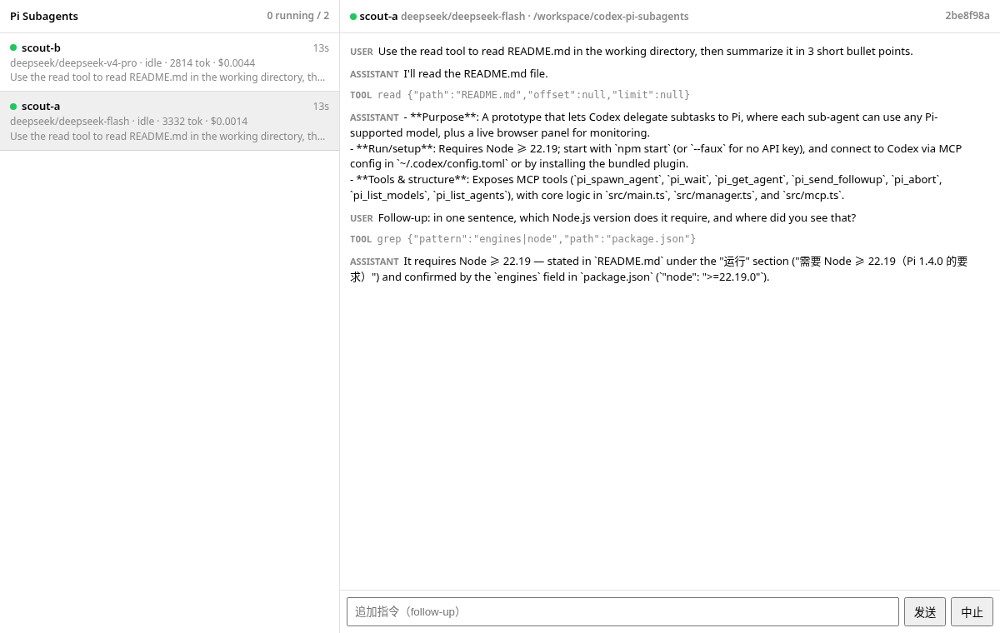

# codex-pi-subagents

让 [Codex](https://github.com/openai/codex) 把子任务交给 [Pi](https://pi.dev) 执行：每个子 agent 可以用 Pi 支持的任意模型（DeepSeek、Anthropic、Gemini、OpenRouter、本地模型……），并提供一个实时 Web 面板，可在普通浏览器或 ChatGPT 桌面 app 的内置浏览器中打开。



```
Codex ──MCP (streamable HTTP)──▶ codex-pi-subagents 常驻服务 ──Pi SDK──▶ AgentSession × N（各自的模型）
                                        │
                                        └── http://127.0.0.1:7788  Web 面板（SSE 实时）
```

## 为什么

Codex 原生子 agent 只能沿用父会话的 model provider（自定义 agent 文件里的 `model_provider` 不生效）。本项目把子 agent 交给 Pi，因此每个子任务都能单独选模型、选 provider。

## 功能

- MCP 工具：`pi_list_models`、`pi_spawn_agent`、`pi_wait`、`pi_get_agent`、`pi_send_followup`、`pi_abort`、`pi_list_agents`
- 多个 Pi 会话在同一进程并发运行，每个会话可指定模型、thinking 等级、工作目录，工具可选 `coding` 或 `read-only` 两种预设
- 会话以 JSONL 持久化；服务重启后面板日志从 JSONL 恢复，follow-up 可以接着原来的上下文继续
- Web 面板：agent 列表、状态、token 和费用、实时输出、工具调用，可发送 follow-up 或中止；左下角可切换默认模型（`spawn` 未指定 model 时优先生效，持久化到 `--data` 目录）
- Codex 插件：打包 MCP 配置和一个 skill，skill 告诉 Codex 何时以及如何委派给 Pi
- `--faux` 离线假模型：不需要任何 API key 就能跑通整条链路

## 安装

需要 Node ≥ 22.19（Pi 1.4.0 的要求）。

```bash
git clone https://github.com/Caho1/codex-pi-subagents
cd codex-pi-subagents
npm install
npm start                 # 使用 Pi 已配置的模型（环境变量或 ~/.pi/agent）
npm start -- --faux       # 离线假模型，用于试跑
npm run check             # 类型检查
npm run smoke -- /path/to/project   # 通过 MCP 做冒烟测试（需要服务已启动）
SMOKE_FAUX=1 MCP_URL=http://127.0.0.1:7789/mcp npm run smoke -- /path/to/project  # 仅选择 faux 模型，服务须以 --faux 启动
```

参数：`--port 7788`、`--host 127.0.0.1`、`--data ~/.codex-pi-subagents`（agent 索引和会话 JSONL 的存放目录）、`--stdio`（同时在 stdio 上提供 MCP）。也可用环境变量 `PI_SUBAGENTS_PORT`、`PI_SUBAGENTS_DATA` 设置。

使用 `--host 0.0.0.0` 并通过自定义域名访问时，添加 `--allow-host example.local`；多个域名可重复传入该参数。Host 和 Origin 校验用于限制浏览器跨站请求，不能替代身份认证。

面板和默认 `pi_list_models` 只显示真实模型。服务启用 `--faux` 后，可调用 `pi_list_models` 并传入 `include_faux: true` 查看离线测试模型。

面板地址是 http://127.0.0.1:7788 ，每个工具结果里都带 `panel` 链接。

## 模型：DeepSeek

Pi 内置 `deepseek` provider（OpenAI 兼容，`https://api.deepseek.com`），只读环境变量 `DEEPSEEK_API_KEY`，不需要 models.json：

```bash
export DEEPSEEK_API_KEY=...    # 不要写进任何文件
npm start
```

`pi_list_models` 会返回 `deepseek/deepseek-flash` 和 `deepseek/deepseek-v4-pro`（以 DeepSeek `/models` 接口实际返回为准）。其他 provider 见 Pi 文档 [providers.md](https://github.com/earendil-works/pi/blob/main/packages/coding-agent/docs/providers.md) 和 [models-configuration.md](https://github.com/earendil-works/pi/blob/main/packages/coding-agent/docs/models-configuration.md)。

## 接入 Codex

先启动本服务，然后任选下面一种方式。

### 方式 A：插件（推荐）

插件会带上 MCP 连接和 `pi-subagents` skill。

```bash
codex plugin marketplace add ./codex-plugin
# => Added marketplace `pi-subagents-local` from …/codex-plugin
codex plugin add pi-subagents@pi-subagents-local
# => Added plugin `pi-subagents` from marketplace `pi-subagents-local`
#    Installed plugin root: ~/.codex/plugins/cache/pi-subagents-local/pi-subagents/0.1.0
```

安装后 `~/.codex/config.toml` 会自动写入 `[plugins."pi-subagents@pi-subagents-local"] enabled = true`。插件自带的 MCP 工具默认需要逐次审批，在 `~/.codex/config.toml` 里放行（加在插件段之后）：

```toml
[plugins."pi-subagents@pi-subagents-local"]
enabled = true

[plugins."pi-subagents@pi-subagents-local".mcp_servers.pi-subagents]
default_tools_approval_mode = "approve"
```

验证：`codex plugin list` 应出现 `pi-subagents-local`；服务运行时 `curl http://127.0.0.1:7788/mcp` 可达。改完 config 后重启 Codex 生效。

### 方式 B：手动配置 mcp_servers

```toml
[mcp_servers.pi-subagents]
url = "http://127.0.0.1:7788/mcp"
tool_timeout_sec = 300             # pi_wait 最多阻塞 240 秒
default_tools_approval_mode = "approve"
```

这种方式没有 skill。需要在提示词或 AGENTS.md 里说明"用 pi_spawn_agent 委派子任务"。

### 可选：只用 Pi，关掉原生子 agent

```toml
[agents]
enabled = false
```

不关的话两套工具并存。实测装了插件以后，即使原生子 agent 开着，Codex 收到"用子 agent 做 X"这类请求也会按 skill 选择 Pi。

### 可选：Codex 父模型也用 DeepSeek

DeepSeek 支持 OpenAI Responses API，满足 Codex 唯一支持的 `wire_api = "responses"`：

```toml
model = "deepseek-flash"
model_provider = "deepseek"

[model_providers.deepseek]
name = "DeepSeek"
base_url = "https://api.deepseek.com/v1"
env_key = "DEEPSEEK_API_KEY"
wire_api = "responses"
```

## 用法示例

在 Codex 里：

```
Review src/ for real bugs. Use two subagents in parallel — one on deepseek-v4-pro, one on deepseek-flash — both read-only. Wait for both and merge the findings.
```

Codex 会依次调用 `pi_list_models`、`pi_spawn_agent` ×2、`pi_wait`，然后汇总结果。运行过程可以在面板里实时查看。

## 文件

| 路径 | 作用 |
|---|---|
| `src/main.ts` | HTTP 服务：`/mcp`、面板、`/api`、SSE |
| `src/manager.ts` | 用 Pi SDK 管理多个 AgentSession：事件、用量、follow-up、中止、持久化 |
| `src/mcp.ts` | MCP 工具定义 |
| `src/panel.html` | 面板（原生 JS，无需构建） |
| `src/codex-avatars.js` / `src/codex-icons.js` | 从本机 Codex bundle 提取的头像和图标资产 |
| `src/faux.ts` | 离线假模型（含 `SIMULATE_ERROR` 出错测试） |
| `codex-plugin/` | Codex 插件和本地 marketplace |
| `scripts/smoke.ts` | MCP 冒烟测试 |
| `scripts/mock-responses.mjs` | 测试用的假 OpenAI Responses 端点，在没有模型凭据时充当 Codex 的父模型 |

## 已知限制

- 原型阶段：已在 Codex CLI 0.164.0 + Pi 1.4.0 + DeepSeek 上实测，未在 ChatGPT 桌面 app 的内置浏览器中验证。
- Codex 通过阻塞的 `pi_wait` 等待结果，还没有在完成时主动唤醒 Codex（计划通过 App Server 的 `turn/start` 实现）。
- 子 agent 不受 Codex 沙箱约束，权限由 Pi 的工具决定。用于探索或评审时请用 `tools: "read-only"`；多个子 agent 同时写文件没有隔离（尚无 worktree 支持）。
- 子 agent 看不到 Codex 的对话，任务描述必须写完整。
- 面板和 MCP 没有鉴权，只监听 127.0.0.1，不要绑定到公网地址。
- MCP 工具无法主动打开浏览器标签页，面板需要用户点链接打开，或在桌面 app 里用 `@Browser` 打开。
- Codex 对非 OpenAI 模型会提示 "Model metadata not found"，改用默认元数据。

## License

MIT
